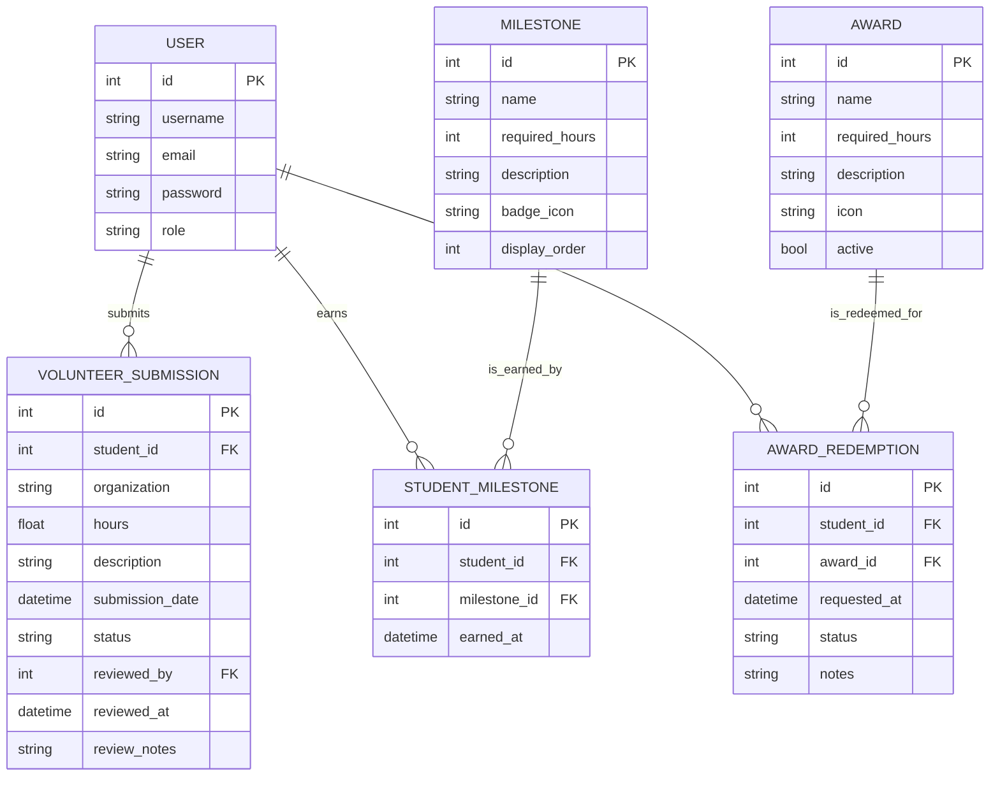

# COMP 3613 Assignment 1

Draft this file with the Guide. **Update it after every phase milestone** before you pause. The use-case diagram is a UML PNG at `docs/diagrams/use-case.png`, linked from this file as `diagrams/use-case.png` (path relative to `docs/report.md`). The model diagram is Mermaid. **Embed wireframe images** as `wireframes/<file>` (files live in `docs/wireframes/`).

Do not put your student ID in this file if you will commit it. The PDF cover adds your name and ID at export time.

## Assigned project

**Campus Rewards**, based on the assigned brief **Student Awards (incentive system)**.

Students gain hours by volunteering, appear on a leaderboard, unlock milestones, and redeem progress for prizes / awards. This MVP follows the three named workflows below. Screen steps belong in the Phase 4 wireframes.

## Three workflows

### 1. Submit and Verify Volunteer Hours (Student)

### 2. Track Progress and Earn Milestones (Student)

### 3. Redeem Awards (Student)

## Use case diagram

Phase 2 notes: Phase 1 keeps **Submit and Verify Volunteer Hours (Student)** as the named workflow; the diagram splits it into **Submit Volunteer Hours** (Student) and **Verify Volunteer Hours** (Administrator) with no «include» / «extend». **Track Progress and Earn Milestones** is standalone (Student). **Redeem Awards** «include» **Check Award Eligibility**. **View Submission Status** is shared by Student and Administrator (role-appropriate access). Actors on opposite sides.

## Model diagram

The Phase 3 draft was refined during Phase 5 to match the implemented SQLModel schema and the actual business rules used by the app.

Phase 5 model revisions:

- The app uses a single USER table with role-based access (`regular_user` and `admin`) rather than separate student and administrator tables.
- Student and milestone relationships are stored through `StudentMilestone` as a many-to-many join record with earned timestamps.
- Volunteer submissions include review metadata and status tracking so admin verification is supported directly in the data model.
- Award redemptions are tracked as separate records per request, allowing status history and review notes.
- Student progress and milestone state are derived from approved hours and earned milestone records, which matches the actual route and service logic in the app.

## Wireframes

Phase 4 wireframes are saved in [docs/wireframes](wireframes) and embedded below for the three named workflows.

### 1. Submit and Verify Volunteer Hours (Student)

### 2. Track Progress and Earn Milestones (Student)

### 3. Redeem Awards (Student)

## Theming

The app uses a blue-and-white academic brand with a modern, friendly professional tone. The visual system is applied across the landing page, login/register screens, and the authenticated student/admin dashboards.

- Palette: deep blue, navy, soft white, and light steel accents
- Tone: confident, approachable, student-friendly, and campus-appropriate
- Wordmark: “Campus Rewards” as the top-level brand name
- UI treatment: soft cards, rounded panels, highlight states for active navigation, and action-driven buttons for milestone and reward actions

This was applied to the public landing view and the authentication pages, then carried through the student dashboard and admin review screen for consistent workflow UX.

## Implementation notes

Phase 5 implementation follows the named workflows and keeps the app architecture layered as required: routes call services, services call repositories, and SQLModel entities define the data layer.

### Workflow 1 — Submit and Verify Volunteer Hours
- Student can create a volunteer-hours submission with organization, hours, and notes.
- Submission is stored as a pending record and remains visible on the student dashboard until reviewed.
- Admin can approve or reject submissions from the admin dashboard.
- Approved hours contribute to total approved volunteer time.

### Workflow 2 — Track Progress and Earn Milestones
- Total approved hours are calculated from student submissions.
- Milestone thresholds are listed and tracked by required hours.
- Student sees earned, in-progress, and locked milestones.
- Milestone records are synced to the student milestone table once approval updates the totals.

### Workflow 3 — Redeem Awards
- Awards are seeded with required-hour thresholds.
- Student must meet the eligibility threshold before redemption is allowed.
- Redemption requests are stored with status metadata and remain visible in the student dashboard.

### Phase 5 verification notes
- Database bootstrap and seeding complete successfully.
- Demo login accounts work as expected.
- Student dashboard renders the workflow sections for submission, progress, and award redemption.
- Admin dashboard renders pending review items for verification.
- The current local implementation is ready for Phase 5 polish review and is not yet deployed.

## Deployed app

Phase 6 has not started, and no public Render deployment is active for this project.

This local app remains a Phase 5 implementation only.

## Logins

The seeded demo accounts required for workflow testing are:

- bob / bobpass — regular_user
- admin / adminpass — admin

## YouTube URL

Not added yet. This is a Phase 5 local-build document; the final presentation link belongs in the Phase 6 report/export stage.

## Session transcripts

Filled when the Guide builds the report: the agent writes each Guide chat to `docs/transcripts/<slug>.md` (Copilot Agent, Cursor, or OpenCode). `python manage.py report` packages them. Do not paste chats here during the build.

## Competency (student-judge)

Filled when the report is built. Guide runs student-judge, writes `docs/judge.md`, and export appends the scorecard here.

## Skill integrity

Filled by `python manage.py report`. Do not edit the course skills.
