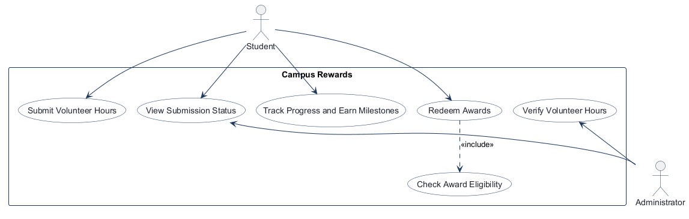
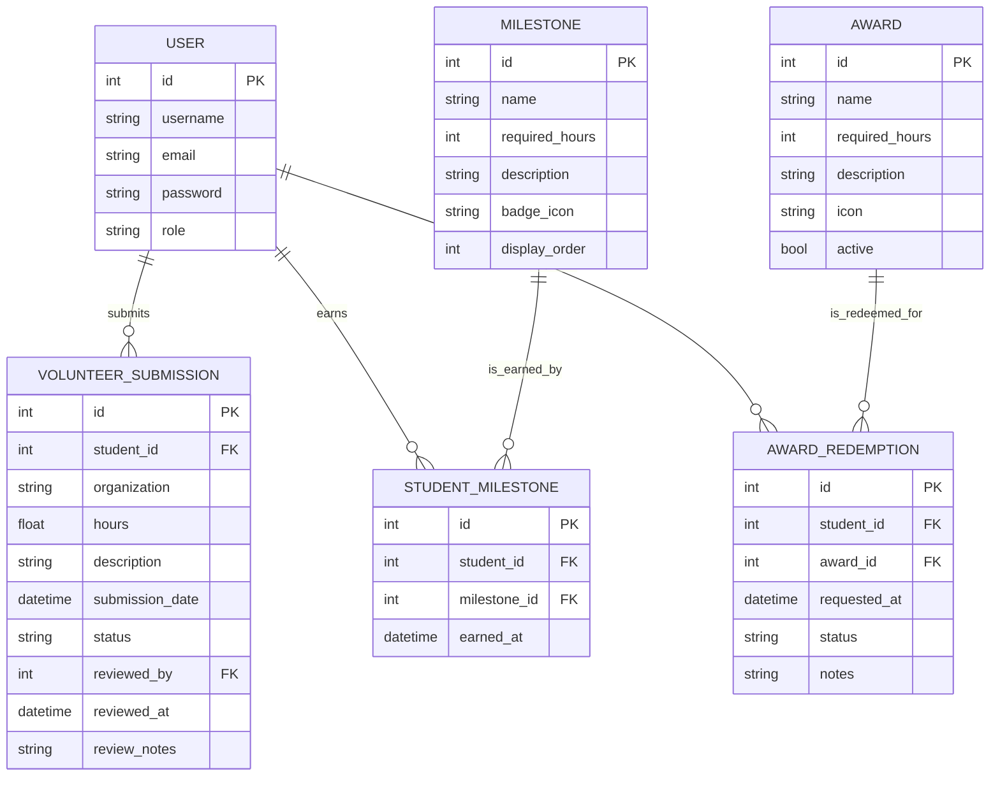

<!-- student-build:skill-integrity
status: pass
root: e84cd692d0b85eefe546385661958c27d07e8be6c5176a82012f68ccff5c8beb
expected_root: e84cd692d0b85eefe546385661958c27d07e8be6c5176a82012f68ccff5c8beb
mismatches: none
-->

# COMP 3613 Assignment 1

Campus Rewards project report for COMP 3613 Assignment 1.

## Submission details

- GitHub repository: https://github.com/Hakeem-Ali/comp3613a1
- YouTube URL: [COMP3613A1 – Campus Rewards Project Demonstration](https://www.youtube.com/watch?v=8azxc4LcmtY)
- Agent used: GitHub Copilot CLI
- Account email: hakeem.samad.ali00@gmail.com

## Assigned project

**Campus Rewards**, based on the assigned brief **Student Awards (incentive system)**.

Students gain hours by volunteering, appear on a leaderboard, unlock milestones, and redeem progress for prizes / awards. This MVP follows the three named workflows below. Screen steps belong in the Phase 4 wireframes.

## Three workflows

### 1. Submit and Verify Volunteer Hours (Student)

### 2. Track Progress and Earn Milestones (Student)

### 3. Redeem Awards (Student)

## Use case diagram

Phase 2 notes: Phase 1 keeps **Submit and Verify Volunteer Hours (Student)** as the named workflow; the diagram splits it into **Submit Volunteer Hours** (Student) and **Verify Volunteer Hours** (Administrator) with no «include» / «extend». **Track Progress and Earn Milestones** is standalone (Student). **Redeem Awards** «include» **Check Award Eligibility**. **View Submission Status** is shared by Student and Administrator (role-appropriate access). Actors on opposite sides.

## Model diagram

The Phase 3 draft was refined during Phase 5 to match the implemented SQLModel schema and the actual business rules used by the app.

Phase 5 model revisions:

- The app uses a single USER table with role-based access (`regular_user` and `admin`) rather than separate student and administrator tables.
- Student and milestone relationships are stored through `StudentMilestone` as a many-to-many join record with earned timestamps.
- Volunteer submissions include review metadata and status tracking so admin verification is supported directly in the data model.
- Award redemptions are tracked as separate records per request, allowing status history and review notes.
- Student progress and milestone state are derived from approved hours and earned milestone records, which matches the actual route and service logic in the app.

## Wireframes

Phase 4 wireframes are saved in [docs/wireframes](wireframes) and embedded below for the three named workflows.

### 1. Submit and Verify Volunteer Hours (Student)

### 2. Track Progress and Earn Milestones (Student)

### 3. Redeem Awards (Student)

### Redeem Rewards (Student)

.png)

### Submit Volunteer Hours (Student)

.png)

### Track Progress and Earn Milestones (Student)

.png)

### Redeem Rewards (Student)

.png)

### Submit Volunteer Hours (Student)

.png)

### Track Progress and Earn Milestones (Student)

.png)

### Redeem Rewards (Student)

.png)

### Submit Volunteer Hours (Student)

.png)

### Track Progress and Earn Milestones (Student)

.png)

### Redeem Rewards (Student)

.png)

### Submit Volunteer Hours (Student)

.png)

### Track Progress and Earn Milestones (Student)

.png)

## Theming

The app uses a blue-and-white academic brand with a modern, friendly professional tone. The visual system is applied across the landing page, login/register screens, and the authenticated student/admin dashboards.

- Palette: deep blue, navy, soft white, and light steel accents
- Tone: confident, approachable, student-friendly, and campus-appropriate
- Wordmark: “Campus Rewards” as the top-level brand name
- UI treatment: soft cards, rounded panels, highlight states for active navigation, and action-driven buttons for milestone and reward actions

This was applied to the public landing view and the authentication pages, then carried through the student dashboard and admin review screen for consistent workflow UX.

## Implementation notes

Phase 5 implementation follows the named workflows and keeps the app architecture layered as required: routes call services, services call repositories, and SQLModel entities define the data layer.

### Workflow 1 — Submit and Verify Volunteer Hours
- Student can create a volunteer-hours submission with organization, hours, and notes.
- Submission is stored as a pending record and remains visible on the student dashboard until reviewed.
- Admin can approve or reject submissions from the admin dashboard.
- Approved hours contribute to total approved volunteer time.

### Workflow 2 — Track Progress and Earn Milestones
- Total approved hours are calculated from student submissions.
- Milestone thresholds are listed and tracked by required hours.
- Student sees earned, in-progress, and locked milestones.
- Milestone records are synced to the student milestone table once approval updates the totals.

### Workflow 3 — Redeem Awards
- Awards are seeded with required-hour thresholds.
- Student must meet the eligibility threshold before redemption is allowed.
- Redemption requests are stored with status metadata and remain visible in the student dashboard.

### Seeded demo data

- Milestones: Bronze Contributor (10 hours), Silver Contributor (40), Gold Contributor (80), and Platinum Contributor (120).
- Awards: Campus T-Shirt (25 hours), Gift Card (50), and Wireless Headphones (75).
- The seeded student and administrator accounts are listed under Logins.

### Phase 5 verification notes
- Database bootstrap and seeding complete successfully on the live Render deployment.
- Demo login accounts work as expected.
- Student dashboard renders the workflow sections for submission, progress, and award redemption.
- Admin dashboard renders pending review items for verification.
- The app is deployed and verified on Render; there are no recent deploy/build errors in the service event history.

## Deployed app

Confirmed live URL: https://faststarter-hnhf.onrender.com

Verified deployment evidence:

- `/health` responded successfully with `{"ok": true}`.
- The app was successfully served in the browser and accepted the user login flow.
- The student submission workflow succeeded: a new volunteer-hours request was created and showed the success message “Your volunteer hours were submitted and are awaiting review.”
- The admin review workflow succeeded: the review action showed “Submission approved and milestone progress updated.”
- The Render workspace contains both `faststarter` (web service) and `faststarter-db` (free PostgreSQL database), both in the same project and both marked available.
- The app’s database bootstrap code uses the `DATABASE_URI` environment setting and converts Render `postgres://` URLs into the SQLAlchemy Postgres driver (`postgresql+psycopg2://...`), which is the path used when the service is configured for PostgreSQL rather than SQLite. The actual URI value was not exposed.
- The most recent deployment events for the web service were successful build/deploy completions, with no recent database connectivity failures in the service history.

## PostgreSQL status

Verified on the current Render workspace:

- The web service `faststarter` and the PostgreSQL database `faststarter-db` both exist in the same workspace and are available.
- The service is configured for the Render Postgres-backed deployment path, and the app code path uses `DATABASE_URI` rather than falling back to SQLite.
- The live app continued to serve successfully after the database-backed deployment, and there were no recent database connection errors in the latest deployment event history.

This confirms the production app is using PostgreSQL through the Render database connection, without exposing the database secret.

## Verified workflow results

### 1. Volunteer-hours submission and admin approval

Verified on the live app:

- Student login succeeded with the seeded `bob` account.
- A new volunteer-hours submission was accepted and showed: “Your volunteer hours were submitted and are awaiting review.”
- Admin login succeeded with the seeded `admin` account.
- The admin approval action succeeded and showed: “Submission approved and milestone progress updated.”

### 2. Student progress and milestone workflow

Verified on the live student dashboard after approval of 25 total approved hours:

- Total approved hours: `25.0`
- Bronze Contributor: earned
- Silver Contributor: locked
- Gold Contributor: locked
- Next milestone: `Silver Contributor`

### 3. Award redemption workflow

Verified on the live student dashboard after the approved total crossed the award threshold:

- Campus T-Shirt requirement: `25 hours required`
- Award status after approval: available for redemption
- Redeem action succeeded and produced: “Your Campus T-Shirt redemption request was submitted.”

## Final Phase 6 status

Verified complete for the live Render deployment:

- Web service: `faststarter` is live at https://faststarter-hnhf.onrender.com
- PostgreSQL database: `faststarter-db` is present and available in the same Render workspace
- Health endpoint: `/health` returned `{"ok": true}`
- Workflow 1: volunteer-hours submission and admin approval both passed
- Workflow 2: approved hours and milestone state updated correctly
- Workflow 3: award redemption succeeded at the 25-hour threshold

No secrets were exposed, no Render resources were created, and there were no recent deployment errors in the service history.

## Logins

The seeded demo accounts required for workflow testing are:

- bob / bobpass — regular_user
- admin / adminpass — admin

## YouTube URL

**COMP3613A1 – Campus Rewards Project Demonstration**
https://www.youtube.com/watch?v=8azxc4LcmtY

The YouTube page was reachable and displayed the supplied title with a 3:23 runtime. The watch page did not expose its visibility setting; confirm it is Unlisted or Public before submission.

## Session transcripts

Guide packaged **1** chat(s) in `docs/transcripts/` (and `docs/transcripts.zip`).

Index: [docs/transcripts/INDEX.md](transcripts/INDEX.md)

- [`report-generation`](transcripts/report-generation.md)

## Competency (student-judge)

**Judged at:** 2026-10-13T00:04:09-04:00
**Evidence pass:** read current docs/report.md, diagrams, wireframes, source architecture, and all available native session contexts; prior judge.md ignored

# student-judge competency report

**Student / session:** Hakeem Ali / report-generation conversation
**Artifact:** Current Copilot CLI report-generation chat, project artifacts, and available session metadata. Earlier phase session contents were not retrievable.
**Phases in evidence:** COMP 3613 phases 1–6 (Phase 5 polish; Phase 6 deploy)

### Totals
| | Count / value |
|--|--|
| Metrics on rubric | 12 (M1–M12) |
| N/A (excluded) | 10: M1–M5, M7–M9, M11–M12 (no readable phase conversations to assess these behaviors) |
| Metrics scored | 2 |
| Scoreable max | 2 × 4 = 8 |
| Awarded total | 6 / 8 |
| **Overall (avg of scored)** | **3.0 / 4** |
| Impression mark | 15 / 20 (no Guide confidence log; calculated from 3.0 / 4) |

## Scorecard

| ID | Metric | Score / 4 | In avg | Evidence |
|----|--------|----------:|:------:|----------|
| M1 | Phase discipline | N/A | no | Earlier phase chats are unavailable; the export chat does not cover phase sequencing. |
| M2 | Problem framing | N/A | no | The report records the project and three workflows, but the student’s design-phase answers are not available. |
| M3 | Decision ownership | N/A | no | Project artifacts alone do not establish who made the design decisions. |
| M4 | Artefact-before-code | N/A | no | Diagrams and wireframes exist, but the inaccessible conversations prevent judging their use before implementation. |
| M5 | Verification habit | N/A | no | The report records live workflow results, but no readable student turn establishes the verification process or polish feedback. |
| M6 | Assignment fit | 3 | yes | The report documents the named workflows and layered design. A targeted search of `app/routers/` found no inline SQL or ORM persistence operations. |
| M7 | Slice explanation | N/A | no | No accessible chat shows whether code checks or snippets were assigned; missing snippets are not treated as a student gap. |
| M8 | Prompt quality | N/A | no | No design or implementation prompts are available to assess. |
| M9 | Response to pushback | N/A | no | No readable refinement turns are available. |
| M10 | Integrity | 3 | yes | No paste-back, bypass, or skill-edit signal appears in the readable report-generation exchange; final skill integrity is checked by the export process. |
| M11 | Provenance continuity | N/A | no | The project artifacts are coherent, but the missing phase chats prevent a continuity assessment. |
| M12 | Sincerity trajectory | N/A | no | No sincerity blocks or Guide confidence logs were available; no trajectory can be assessed. |

## Strengths
- The current report contains three named workflows, a UML use-case diagram, a Mermaid model, three embedded wireframes, implementation notes, a deployed URL, and marker logins.
- The documented schema and routes align with the required layered architecture; the final router search found no direct persistence calls.
- The live YouTube watch page displayed the provided demonstration title and a 3:23 runtime.

## Gaps (priority order)
1. The phase 1–6 conversations are not present in retrievable transcripts. Two earlier Copilot CLI session records were visible, but both returned empty conversation histories; student ownership, code-check opportunities, and phase-by-phase polish therefore remain unassessed.
2. The report records behavior verification but does not provide a readable student-authored local verify/mismatch note or a specific UI/workflow polish iteration. Phase 5’s student-steered polish cannot be confirmed from the available evidence.
3. The YouTube watch page did not reveal whether the video is Unlisted or Public; confirm its visibility before submission.

## Phase gate status
| Phase | Status | Note |
|-------|--------|------|
| 1 | met | Project and three workflows are recorded in the report; student ownership is not independently confirmed by chat. |
| 2 | met | Use-case JSON and PNG are present, and the report describes include/extend and shared-status relationships. |
| 3 | met | The report includes the Mermaid ERD and Phase 5 model revision notes. |
| 4 | met | Three wireframe files exist and are embedded in the report. |
| 5 | partial | Workflow implementations and verification are documented, but readable evidence of student-led local verification and polish is missing. |
| 6 | met | The report contains the public Render URL, PostgreSQL deployment notes, workflow results, and marker logins. |

## Recommended next practice
- Reopen/export the earlier Guide conversations and capture one clear student observation against a wireframe plus the resulting UI, workflow, or model refinement.

## Integrity note
- Clean based on available evidence; older phase conversations were not retrievable, so integrity outside the current report-generation exchange cannot be independently assessed.

## Provenance flags
- Two prior Copilot CLI session records were visible by metadata but returned no transcript content. No paste-back evidence was present in the readable exchange.

## Sincerity log summary
- Blocks found: 0 | max round: N/A | min/mean/final confidence: not logged | trend: unavailable | cleared: no spiral recorded; prior chat content unavailable

## Skips
- Skips: not verifiable/3 used (no readable phase transcript or skip record)

## Skill integrity

Course skills are hashed at export and compared to `.agents/skills.lock.json`. Do not edit `.agents/skills/`, `.cursor/skills/`, or `AGENTS.md`.

- Status: **pass**
- Root: `e84cd692d0b85eefe546385661958c27d07e8be6c5176a82012f68ccff5c8beb`
- none
